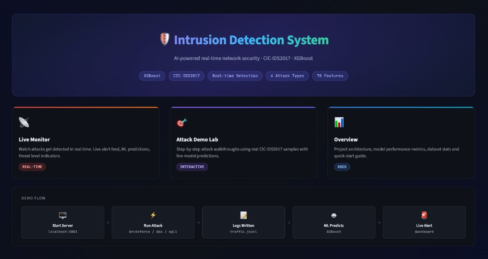
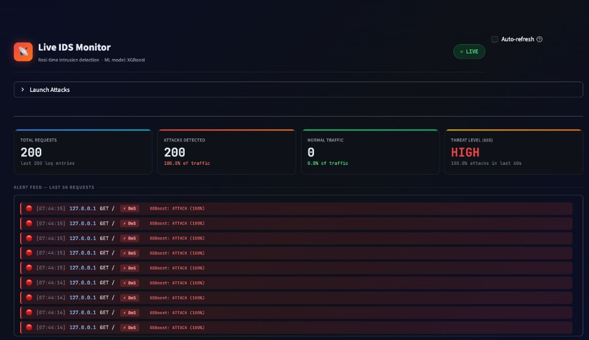
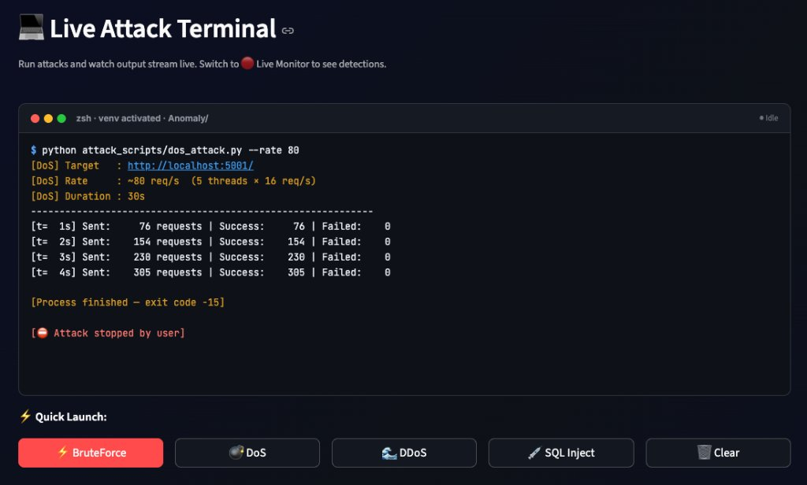
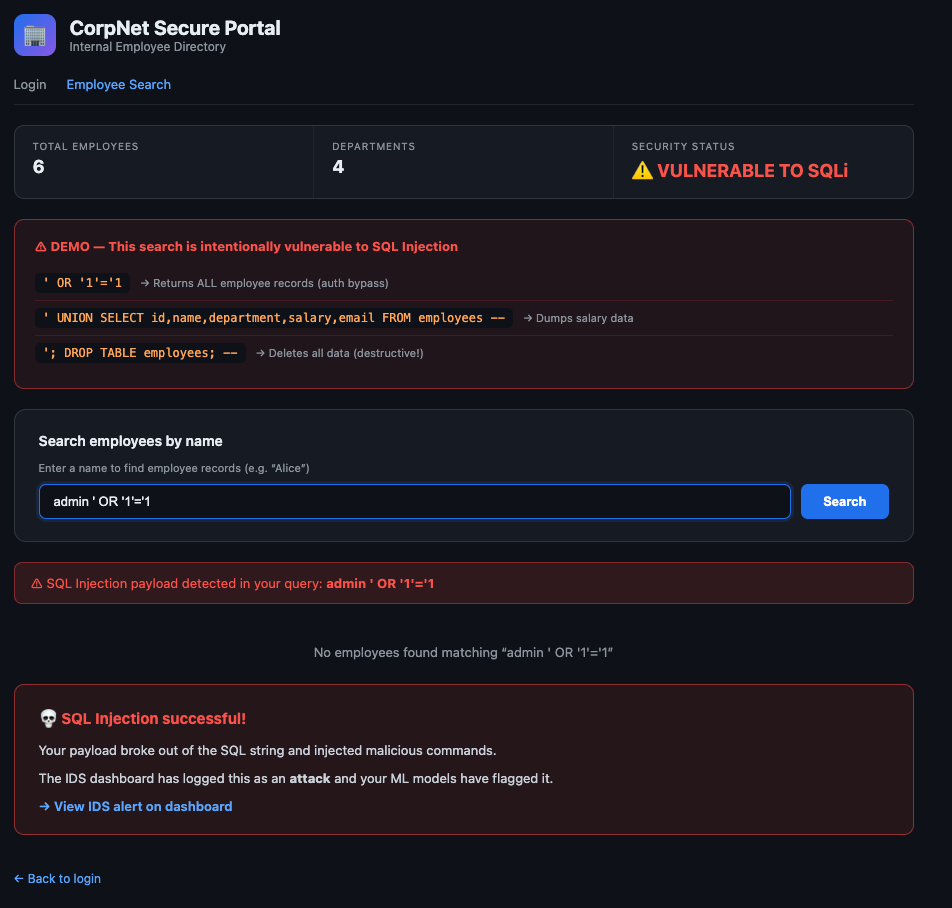

# 🛡️ Intrusion Detection System (IDS)

> **AI-powered real-time network intrusion detection** using Machine Learning — includes a live vulnerable target website, real attack scripts, an in-browser attack terminal, and an interactive Streamlit dashboard that detects attacks as they happen.

<div align="center">


<br/><br/>



</div>

---

## 📋 Table of Contents

- [About the Project](#-about-the-project)
- [Screenshots & Demo](#-screenshots--demo)
- [System Architecture](#️-system-architecture)
- [Project Structure](#-project-structure)
- [Attack Types](#-attack-types-demonstrated)
- [ML Model](#-ml-model)
- [Dashboard Pages](#-dashboard-pages)
- [Quick Start](#-quick-start)
- [Dataset Setup](#-dataset-setup)
- [Evaluation Metrics](#-evaluation-metrics)
- [Tech Stack](#️-tech-stack)
- [Contributors](#-contributors)
- [Disclaimer](#️-disclaimer)

---

## 📌 About the Project

This project is a **fully functional Intrusion Detection System** built for educational and demonstration purposes. It simulates a real-world cybersecurity environment where:

1. A **vulnerable Flask web server** (target) accepts requests and logs all traffic
2. **Attack scripts** simulate real network attacks (BruteForce, DoS, DDoS, SQL Injection)
3. The **XGBoost ML model** (trained on CIC-IDS2017 dataset) classifies each request as Normal or Attack
4. A **Streamlit dashboard** shows live alerts, predictions, and attack analytics in real time

The system uses **smart path-aware classification** to correctly distinguish between attack types — for example, login-endpoint flooding is labeled as `brute_force`, not `dos`.

---

## 📸 Screenshots & Demo

### 🔴 Real-Time Live Monitor
> **Watch ML models catch attacks as they happen** — with live request counters, threat level indicators, XGBoost predictions, and color-coded alert feeds.

<p align="center">
  
</p>

### 💻 In-Browser Attack Terminal & 🌐 Vulnerable Target Web App
> **Simulate cyber attacks with one click** — in-browser attack launcher paired with a vulnerable corporate web portal (CorpNet) demonstrating SQL injection data leaks.

<p align="center">
  
  
</p>

---

## 🏗️ System Architecture

```
┌──────────────────────────────────────────────────────────────┐
│              IDS Dashboard  (Streamlit :8502)                 │
│                                                              │
│   💻 Terminal Page                                           │
│      └── Launch attacks with one click (in-browser)          │
│           ↓                                                  │
│   🖥️  Target Website  (Flask :5001)                          │
│      └── Logs every request to:                              │
│           ↓                                                  │
│   📄 logs/traffic.jsonl                                      │
│      └── Smart attack classification:                        │
│           • /login + high rate   → brute_force               │
│           • Single IP flood      → dos                       │
│           • 3+ IPs flooding      → ddos                      │
│           • SQL payload          → sql_injection             │
│           ↓                                                  │
│   🔴 Live Monitor Page                                        │
│      ├── XGBoost ML Model → predicts each request            │
│      └── Real-time alerts + charts                           │
└──────────────────────────────────────────────────────────────┘
```

**Data Flow:**

```
Attack Script → Target Server (Flask) → traffic.jsonl → XGBoost Model → Live Dashboard Alert
```

---

## 📁 Project Structure

```
IDS/
│
├── 📂 attack_scripts/              # Attack simulation scripts
│   ├── bruteforce.py               # BruteForce login attack
│   ├── dos_attack.py               # DoS HTTP flood (single IP)
│   ├── ddos_attack.py              # DDoS simulation (10 bots, unique IPs)
│   └── sqli_attack.py              # SQL Injection payloads
│
├── 📂 dashboard/                   # Streamlit multi-page dashboard
│   ├── app.py                      # Main entry point + home page
│   ├── shared_sidebar.py           # Shared navigation sidebar
│   └── pages/
│       ├── 1_Overview.py           # Project info, architecture, tech stack
│       ├── 4_Live_Monitor.py       # 🔴 Real-time detection & alert feed
│       ├── 5_Terminal.py           # 💻 In-browser attack launcher
│       └── 6_Attack_Demo.py        # 🎯 Step-by-step attack walkthrough
│
├── 📂 src/                         # Core ML pipeline source code
│   ├── __init__.py
│   ├── data_loader.py              # CIC-IDS2017 / UNSW-NB15 dataset loader
│   ├── preprocessor.py             # Clean → encode → split → scale pipeline
│   ├── trainer.py                  # Unified model training interface
│   ├── evaluator.py                # Metrics, confusion matrix, ROC curves
│   └── models/
│       ├── __init__.py
│       └── xgboost_model.py        # XGBoost classifier definition + tuning
│
├── 📂 target_server/               # Vulnerable Flask web server (demo target)
│   └── app.py                      # Login page, employee search (SQLi vuln), SSE logs
│
├── 📂 data/
│   ├── raw/cicids2017/             # ⚠️ Place CIC-IDS2017 CSV files here (not in repo)
│   └── processed/                  # Auto-generated: numpy arrays + preprocessor.pkl
│       └── demo_samples.json       # Pre-processed samples for live dashboard demo
│
├── 📂 models/                      # Saved trained model files (auto-generated)
│   ├── xgboost.pkl                 # Trained XGBoost classifier
│   └── training_times.pkl          # Training time logs
│
├── 📂 logs/                        # Runtime traffic logs (auto-generated)
│   └── traffic.jsonl               # Live request log (JSON Lines format)
│
├── 📂 reports/figures/             # Auto-generated evaluation plots
│   ├── confusion_matrices.png
│   ├── roc_curves.png
│   ├── metrics_comparison.png
│   ├── xgboost_confusion_matrix.png
│   ├── xgboost_roc_curve.png
│   └── model_comparison.csv
│
├── 📂 .streamlit/
│   └── config.toml                 # Streamlit configuration (disable telemetry)
│
├── run_pipeline.py                 # 🚀 One-click: train + evaluate the full pipeline
├── setup.sh                        # Environment setup script
├── requirements.txt                # Python dependencies
├── .gitignore
└── README.md
```

---

## ⚔️ Attack Types Demonstrated

| Attack | Script | Target Endpoint | How It's Classified |
|--------|--------|-----------------|---------------------|
| **BruteForce** | `bruteforce.py` | `/login` (port 5001) | Repeated POST attempts to auth endpoint |
| **DoS** | `dos_attack.py` | `/` (port 5001) | High request rate from a **single** IP |
| **DDoS** | `ddos_attack.py` | `/` (port 5001) | High rate from **3+ unique** IPs simultaneously |
| **SQL Injection** | `sqli_attack.py` | `/search` (port 5001) | SQL keywords detected in query payload |

### 🧠 Smart Path-Aware Classification Logic

The target server uses intelligent, multi-signal classification to avoid mislabeling:

```
/login endpoint + count > 5           → brute_force
count > 15 AND unique flooding IPs ≥ 3 → ddos
count > 15 (single IP)                → dos
SQL keywords in payload               → sql_injection
```

### 🗄️ Manual SQL Injection Demo
1. Open **http://localhost:5001/search**
2. Type `' OR '1'='1` → dumps **all** employee records
3. Try `' UNION SELECT id,name,department,salary,email FROM employees --`
4. Watch **Live Monitor** tab detect it in real time

---

## 🤖 ML Model

| Model | Algorithm | Dataset | Mode |
|-------|-----------|---------|------|
| **XGBoost** | Gradient Boosted Trees | CIC-IDS2017 (30% sample) | Binary Classification |

**Binary Classification:** Normal (0) vs Attack (1)

**Hyperparameters:**
```python
XGBClassifier(
    n_estimators=200,
    max_depth=8,
    learning_rate=0.1,
    subsample=0.8,
    colsample_bytree=0.8,
    min_child_weight=3,
    objective='binary:logistic'
)
```

**Preprocessing Pipeline (in order):**
1. Remove duplicates & constant columns
2. Replace infinity values → NaN → median imputation
3. Binary label encoding (BENIGN=0, everything else=1)
4. Train/Val/Test split (70% / 10% / 20%) — **split before scaling**
5. StandardScaler fit on train only → transform all sets

---

## 📊 Dashboard Pages

| Page | URL | What It Does |
|------|-----|-------------|
| 🏠 **Home** | `localhost:8502` | Hero banner, demo flow, navigation cards |
| 📋 **Overview** | Sidebar → Overview | Architecture, model metrics, dataset info, quick-start |
| 🔴 **Live Monitor** | Sidebar → Live Monitor | Real-time alert feed, XGBoost predictions, threat level, live charts |
| 💻 **Terminal** | Sidebar → Terminal | **In-browser attack launcher** — stream output live, stop anytime |
| 🎯 **Attack Demo** | Sidebar → Attack Demo | Step-by-step walkthrough with live model predictions |

### 💻 In-Browser Terminal Features

| Feature | Detail |
|---------|--------|
| ⚡ Quick Launch | BruteForce, DoS, DDoS, SQL Inject — one click |
| 📺 Real-time Streaming | Output appears line-by-line as the attack runs |
| ⛔ Stop Button | Kill any running attack instantly |
| ⌨️ Custom Commands | Type any shell command in the input box |
| 🔗 Linked to Live Monitor | Switch pages mid-attack to see detections |

---

## 🚀 Quick Start

### Step 1 — Clone & Setup Environment

```bash
git clone https://github.com/YOUR_USERNAME/IDS.git
cd IDS
chmod +x setup.sh
./setup.sh
source venv/bin/activate
```

### Step 2 — Download Dataset

Download **CIC-IDS2017** from Kaggle and place the CSV files in `data/raw/cicids2017/`:

👉 [CIC-IDS2017 on Kaggle](https://www.kaggle.com/datasets/cicdataset/cicids2017)

```
data/raw/cicids2017/
├── Monday-WorkingHours.pcap_ISCX.csv
├── Tuesday-WorkingHours.pcap_ISCX.csv
├── Wednesday-workingHours.pcap_ISCX.csv
├── Thursday-WorkingHours-Morning-WebAttacks.pcap_ISCX.csv
├── Thursday-WorkingHours-Afternoon-Infilteration.pcap_ISCX.csv
├── Friday-WorkingHours-Morning.pcap_ISCX.csv
├── Friday-WorkingHours-Afternoon-DDos.pcap_ISCX.csv
└── Friday-WorkingHours-Afternoon-PortScan.pcap_ISCX.csv
```

### Step 3 — Train the Model

```bash
python run_pipeline.py
```

This will:
- Load & preprocess the CIC-IDS2017 dataset (30% sample for speed)
- Train the XGBoost classifier
- Evaluate and save model + plots to `reports/figures/`
- Saves model to `models/xgboost.pkl`

> ⚡ **Skip this step** if `models/xgboost.pkl` already exists.

### Step 4 — Start the Live Demo

**Terminal 1 — Start the vulnerable target server:**
```bash
source venv/bin/activate
python target_server/app.py
```
> Target running at **http://localhost:5001**

**Terminal 2 — Launch the IDS Dashboard:**
```bash
source venv/bin/activate
streamlit run dashboard/app.py
```
> Dashboard at **http://localhost:8502**

### Step 5 — Run Attacks

**Option A — From the browser (recommended):**
Navigate to **💻 Terminal** page on the dashboard → click any attack button.

**Option B — From CLI:**
```bash
# BruteForce (stops on success)
python attack_scripts/bruteforce.py --stop-on-success

# DoS (single IP flood)
python attack_scripts/dos_attack.py --rate 80

# DDoS (10 simulated bots)
python attack_scripts/ddos_attack.py --threads 10

# SQL Injection
python attack_scripts/sqli_attack.py
```

Then watch the **🔴 Live Monitor** page detect them in real time!

---

## 📥 Dataset Setup

The dataset is **not included** in this repository due to its large size (~500MB). Follow these steps:

**Option 1 — Manual Download (Recommended):**
1. Go to [https://www.kaggle.com/datasets/cicdataset/cicids2017](https://www.kaggle.com/datasets/cicdataset/cicids2017)
2. Download all CSV files
3. Place them in `data/raw/cicids2017/`

**Option 2 — Automatic via pipeline:**
Uncomment `download_cicids2017()` in `run_pipeline.py` (requires Kaggle API credentials).

---

## 📈 Evaluation Metrics

After running `python run_pipeline.py`, the following metrics are computed on the **test set**:

| Metric | Description |
|--------|-------------|
| **Accuracy** | Overall percentage of correct predictions |
| **Precision** | Of predicted attacks, how many were actually attacks |
| **Recall** | Of actual attacks, how many were correctly detected |
| **F1-Score** | Harmonic mean of Precision and Recall (balanced metric) |
| **ROC-AUC** | Area under ROC curve — model's discrimination ability |

Generated plots are saved in `reports/figures/`:
- `confusion_matrices.png` — Normalized confusion matrix
- `roc_curves.png` — ROC curve with AUC score
- `metrics_comparison.png` — Bar chart of all metrics
- `model_comparison.csv` — Tabular results

---

## 🛠️ Tech Stack

| Layer | Technology | Purpose |
|-------|-----------|---------|
| **ML Model** | XGBoost 2.0, scikit-learn 1.3 | Intrusion classification |
| **Data Processing** | Pandas, NumPy, imbalanced-learn | Preprocessing pipeline |
| **Dashboard** | Streamlit 1.28, Plotly | Interactive web UI |
| **Target Server** | Flask, SQLite | Vulnerable demo web app |
| **Terminal** | Python `subprocess` + `threading` + `st.fragment` | Live attack streaming |
| **Visualization** | Matplotlib, Seaborn | Evaluation plots |
| **Dataset** | CIC-IDS2017 (Canadian Institute for Cybersecurity) | Training data |

---

## 👥 Team & Contributors

<table>
  <tr>
    <td align="center">
      <a href="https://github.com/ishant025">
        <br/>
        <sub><b>Ishant Sahu</b></sub>
      </a>
    </td>
    <td align="center">
      <a href="https://github.com/rootmelody">
        <br/>
        <sub><b>Nitin Nirmalkar</b></sub>
      </a>
    </td>
    <td align="center">
      <a href="https://github.com/RAKESH-PARATE">
        <br/>
        <sub><b>Rakesh Parate</b></sub>
      </a>
    </td>
    <td align="center">
      <a href="https://github.com/sageverse-tech">
        <br/>
        <sub><b>Khushraj Varghat</b></sub>
      </a>
    </td>
  </tr>
</table>

---

## ⚠️ Disclaimer

> This project is built **strictly for educational and academic purposes**.
>
> The attack scripts and vulnerable server simulate real cybersecurity scenarios in a **controlled, local environment only**. Never run attack scripts against systems you do not own or have explicit permission to test. The authors are not responsible for any misuse of the code.

---

## 🤝 Acknowledgements

- **Dataset:** [CIC-IDS2017](https://www.unb.ca/cic/datasets/ids-2017.html) — Canadian Institute for Cybersecurity
- **Kaggle Mirror:** [cicdataset/cicids2017](https://www.kaggle.com/datasets/cicdataset/cicids2017)
- Built as part of academic project at **KKMU**

---

<div align="center">
  Made with ❤️ for Cybersecurity Education
</div>
